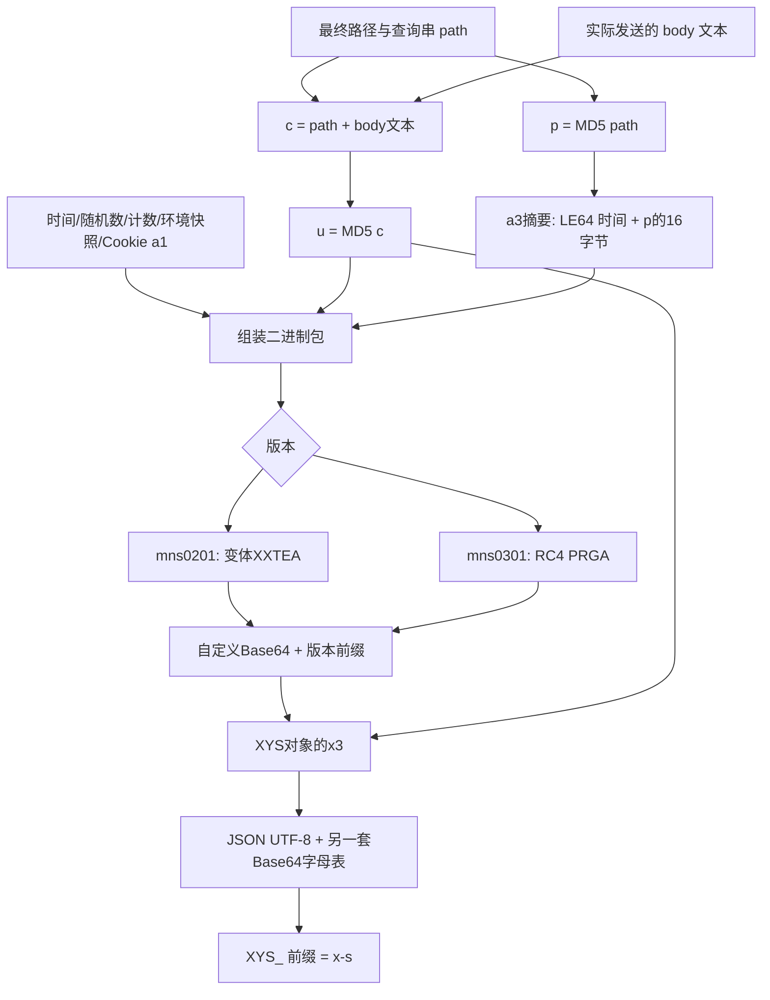

# 从零理解 mnsv2 JSVMP：字段、算法、还原过程与纯 Python 实现

本文只总结这次本地源码、运行日志、浏览器导出脚本和接口测试能支撑的结论。它不是所有小红书版本的通用协议说明。

你可以按这条顺序阅读：先看第1～4节理解整体，再看字段表，最后读代码。只想调用的读者可以直接看第12节。

## 1. 这次到底还原了什么

已实现的计算部分位于 [core/xhs/main.py](../../../../core/xhs/main.py)，运行时不调用 Node、execjs、原始混淆脚本或浏览器。

|部分|状态|说明|
|---|---|---|
|a3 的24字节输入摘要|已独立实现|64组向量与导出的真实模块相同|
|mns0201 的变体XXTEA|已独立实现，可加密和解密|日志24个密文字、旧版完整签名对齐|
|mns0301 的流加密|已独立实现，可加密和解密|固定初始置换表的RC4 PRGA，8组边界长度对齐|
|包组装、MD5、自定义Base64、XYS外层|已实现|Python可生成不含x6/x7的新x-s|
|环境指纹检测与事件采集|尚未完整移植|当前使用显式环境上下文/历史快照|
|x6/x7|尚未生成|有些实测请求不带这两个字段也成功；不能推广到所有请求|
|x-s-common、x-rap-param、Cookie、xsec_token|未由本算法生成|来自用户提供的请求|

所以，“纯 Python 算法”指计算链由 Python 完成，并不意味着没有登录状态或环境输入也能访问接口。

## 2. JSVMP 是什么：把代码藏在解释器后面

普通 JavaScript 直接写出加法、循环和函数调用。JSVMP 则把这类操作编码成一串自定义指令，再由一段 JavaScript 解释器执行。

可以把它理解为：

- 字节码：一份用编号写成的操作清单。
- 解释器：知道每个编号是什么意思的执行程序。
- 操作数栈：临时放数字、对象、函数的工作台。
- 指令指针：标记“读到操作清单的哪里”。
- 作用域/闭包：保存参数、局部变量和上层函数状态。

一个仅用于教学的例子：

```text
PUSH 3     栈变成 [3]
PUSH 5     栈变成 [3, 5]
ADD        取出3和5，相加，再把8放回栈
RETURN     返回8
```

实际样本中，还要处理属性访问、this、call/apply、分支、异常和闭包，因此解释器很大。**JSVMP 是代码的执行/保护方式，不是 XXTEA 或 RC4 这样的加密算法。** 本次是在 JSVMP 执行过程中发现了这些具体算法。

## 3. 本地文件分别负责什么

|文件或标识|作用|
|---|---|
|core/xhs/js/mnsv2.js|Node/JSDOM启动层 + 原始解释器 + 字节码|
|core/xhs/js/vm-instrumentation.cjs|对运行副本插桩，记录原生调用与部分栈运算|
|core/xhs/js/mnsv2.trace.log|执行证据，不是可直接运行的算法|
|core/xhs/js/sign.js|mnsv2外层包装的摘录，说明c/u/p与XYS对象的关系|
|__$c|本样本的大段十六进制字节码|
|_AUuXfEG27Xa3x|旧版解释器的安装/入口符号|
|_0x1233dd|旧版样本的主要执行循环|
|_0x795c5c / _0x17e91c|旧版样本的操作数栈与栈索引|
|_0x415185|旧版样本的指令位置；观察值是十六进制文本索引|
|_0x30ce91|VM生成的函数包装名；不是独立的密码学函数名|

这些变量名只针对捕获版本，不能靠名字判断另一个脚本的算法。解释器中的 Greek I/Ι 等近似字符属性还用于保存函数元数据，视觉上相似并不代表是同一字符。

原本看似巨大的复杂度大多来自解释器和混淆；移植算法时不必把整台虚拟机搬到 Python。

## 4. 从 URL 到 x-s 的完整计算路径



### 4.1 c、u、p 是什么

以不包含查询参数的旧样本为例：

```text
path = /api/redcaptcha/v2/getconfig
body = {}
c    = /api/redcaptcha/v2/getconfig{}
u    = MD5(c)
p    = MD5(path)
```

注意：body是两字符字符串“{}”，不是Python空字典的对象地址，也不是带空格的另一个JSON文本。

本次 GET user_posted 的 path 包含完整查询串，body为空，所以 u=p。签名覆盖的是最终发送的路径和查询，不包括协议和域名。

**参数顺序和编码也是输入的一部分。** `image_formats=jpg,webp` 和 `image_formats=jpg%2Cwebp` 对HTTP业务可能含义相近，但字节不同、MD5就不同。

Python不能先签一个字符串，再让requests重新编码成另一个URL。本次实现先prepare请求，再使用prepared.path_url签名。

### 4.2 x-s 中为什么还有 JSON

x-s不是只有mns密文。它先包装成如下对象，再编码：

```json
{
  "x0": "4.4.3",
  "x1": "xhs-pc-web",
  "x2": "Windows",
  "x3": "mns0301_...",
  "x4": "",
  "x5": "MD5(c)的32字符十六进制串"
}
```

x0是捕获的SDK版本，x1应用标识，x2平台。GET无正文时x4为空；JSON对象/数组正文的捕获包装逻辑通常给出object。Python API 要求调用者明确给body_type，避免猜错。

原JS还有一个条件分支：buildEncSskSign(u)返回结果时才写x6/x7。它们与mns内的“a3状态”是不同的概念，不能混为一谈。本次Python不生成x6/x7。

## 5. 签名前的二进制包长什么样

下面偏移针对a1为52字节、appid为10字节、状态为a3的144字节样本；字符串长度变化会移动后续偏移。

|偏移|字节数|内容|来源|
|---:|---:|---|---|
|0|4|包头79686029|对应小端整数0x29606879，当前捕获值|
|4|4|随机整数R|floor(random * 4294967295)|
|8|8|调用时间T|毫秒时间戳，小端|
|16|8|loadts|环境加载时间，不是每次请求时间|
|24|4|调用计数|同一环境内推进，不能每次都当作1|
|28|4|全局属性数|Object.getOwnPropertyNames(window).length|
|32|4|c的字节长度|UTF-8长度，不是字符数量|
|36|8|摘要片段|hexDecode(u)的前8字节，各自异或R的低8位|
|44|1+52|a1|长度前缀 + UTF-8|
|97|1+10|appid|长度前缀 + UTF-8|
|108|16|环境区段|检测状态、随机字节、掩码等|
|124|1+2|模块状态|a3|
|127|1+16|摘要尾部|a3输出16字节，各自异或R的低8位|

LE表示Little Endian（小端）。例如整数0x12345678，内存字节顺序是78 56 34 12。Python用struct的“<”明确指定小端。

长度前缀使用无符号LEB128：每字节存7位，最高位表示后面还有字节。长度52的前缀只有34（十六进制）；长度128则是80 01。

### 5.1 环境区段并非固定常量

已定位的默认v1区段布局：

|区段内偏移|来源|操作|
|---:|---|---|
|0|版本|1|
|1|R低8位|异或115|
|2|window._ee019d93900dcee2bdafbe5894e6c8a9|异或248|
|3|window.dssts|缺失时观察为255，再异或83；存在值的全部转换分支未完整核实|
|4～11|内部状态100/101/102/103/104/106/107/401|依次异或102/103/201/181/131/99/94/4|
|12|当前分支常量|68|
|13|内部状态109|异或250|
|14～15|当前分支常量|132、21|

状态编号是观测到的内部字段名，尚未把每一位映射成完整的人类语义。初始化检测、事件和动态模块都可能改变它们。提供_f26d64f11eb0f2731d1d03fabcf87c5c时，还可能直接使用其返回数组。

因此Python保留16字节环境快照，**每次重新计算第1号字节**。只复制全部16字节而不更新这一字节，会让指纹内的随机值与包头随机值不一致。

全局属性数1360等数值也是某次快照。加日志钩子、安装脚本都可能改变它；代码没有把它视为永久的浏览器常量。

## 6. a3 摘要：_dsf 的真实计算

_dsf接收两个参数：适配器、24字节输入。捕获版本的a3实现没有读取适配器属性，因此可以从浏览器独立出来。

输入固定为：

```text
LE64(T) + hexDecode(p)
 8字节       16字节    = 24字节
```

输出是16字节。它维护a/b/c/d四个32位状态，每次读取8字节，执行加法、异或、循环左移；最后再混合一次。虽然常量中有常见散列算法使用的数字，这并不足以把它称为标准MD5/Murmur等算法，这里按实际运算实现。

### JavaScript 实现

```js
'use strict';
// Extracted from the captured a3 module. mnsv2 uses exactly 24 input bytes.
const rotl=(x,n)=>((x<<n)|(x>>>(32-n)))>>>0;
function digest24(input){
 const data=Buffer.from(input);if(data.length!==24)throw new RangeError('a3 signature input must contain 24 bytes');
 const n=data.length;let a=0x6d2b79f5^n,b=0x1b873593^(n<<8),c=0x85ebca6b^(n<<16),d=0xc2b2ae35^(n<<24);
 for(let i=0;i<n;i+=8){const x=data.readInt32LE(i),y=data.readInt32LE(i+4);a=rotl((a+x)^c,7);b=rotl((b^x)+d,11);c=rotl((c+y)^a,13);d=rotl((d^y)+b,17);}
 a^=n;b^=a;c=(c+b)>>>0;d^=c;
 a=rotl(a,9);b=rotl(b,13);c=rotl(c,17);d=rotl(d,19);
 a=(a+c)>>>0;b^=d;c=(c+a)>>>0;d^=b;
 const out=Buffer.alloc(16);[a,b,c,d].forEach((v,i)=>out.writeUInt32LE(v>>>0,i*4));return out;
}
function dsf(time,p){if(typeof p!=='string'||! /^[a-fA-F0-9]{32}$/.test(p))throw new TypeError('p must be 16 bytes encoded as hex');const data=Buffer.alloc(24);data.writeBigUInt64LE(BigInt(time));Buffer.from(p,'hex').copy(data,8);return digest24(data);}
module.exports={digest24,dsf};

```

### Python 实现

以下摘自main.py，MASK32=0xffffffff，struct为标准库。

```python
def rotl32(value: int, bits: int) -> int:
    value &= MASK32
    return ((value << bits) | (value >> (32 - bits))) & MASK32


def digest24(data: bytes) -> bytes:
    """a3 模块的 24 字节输入分支；不是 MD5，也不是 XXTEA。"""
    if len(data) != 24:
        raise ValueError("a3 输入必须是 24 字节")
    n = len(data)
    a = 0x6D2B79F5 ^ n
    b = 0x1B873593 ^ (n << 8)
    c = 0x85EBCA6B ^ (n << 16)
    d = 0xC2B2AE35 ^ (n << 24)
    for offset in range(0, n, 8):
        x, y = struct.unpack_from("<II", data, offset)
        a = rotl32((a + x) ^ c, 7)
        b = rotl32((b ^ x) + d, 11)
        c = rotl32((c + y) ^ a, 13)
        d = rotl32((d ^ y) + b, 17)
    a ^= n
    b ^= a
    c = (c + b) & MASK32
    d ^= c
    a, b, c, d = rotl32(a, 9), rotl32(b, 13), rotl32(c, 17), rotl32(d, 19)
    a = (a + c) & MASK32
    b ^= d
    c = (c + a) & MASK32
    d ^= b
    return struct.pack("<IIII", a, b, c, d)


def dsf(timestamp_ms: int, path_digest: str) -> bytes:
    p = bytes.fromhex(path_digest)
    if len(p) != 16:
        raise ValueError("p 必须是 16 字节 MD5 的十六进制字符串")
    return digest24(struct.pack("<Q", timestamp_ms) + p)
```

为什么Python要做 & 0xffffffff？因为Python整数可以一直增长，而JS位运算会将值转成32位。循环移位前先截断，才能让Python的右移对应JS的无符号右移。最终向量验证比“看起来公式一样”更重要。

## 7. mns0201：变体 XXTEA

这版将二进制包按小端装成32位字，最后额外追加一个“原始字节长度”字，再加密。不是简单把包每4字节切开后就结束。

关键参数：

- delta：0x3c6ef373，即1013904243。它不同于常见XXTEA的0x9e3779b9。
- q：6 + floor(52/n)，n含尾部长度字。
- key：ASCII字符串e6483ca2a1eed5e3，共16字节。不能bytes.fromhex后当作8字节key。
- MX位移：z>>>5、y<<2、y>>>3、z<<4。
- 长度：89字节明文变成24个字/96字节密文；144字节明文变成37个字/148字节密文。

### JavaScript 关键循环

```js
const DELTA = 0x3c6ef373;
function mx(z, y, sum, p, e, key) {
  return (((z >>> 5) ^ (y << 2)) + ((y >>> 3) ^ (z << 4)))
       ^ ((sum ^ y) + (key[(p & 3) ^ e] ^ z));
}
// words 为 Uint32Array，已追加原始字节长度；key为4个小端uint32。
function encryptWords(words, key) {
  const n = words.length;
  let z = words[n - 1], sum = 0;
  for (let q = 6 + Math.floor(52 / n); q > 0; q--) {
    sum += DELTA;
    const e = (sum >>> 2) & 3;
    for (let p = 0; p < n; p++) {
      const y = words[(p + 1) % n];
      words[p] = (words[p] + mx(z, y, sum, p, e, key)) >>> 0;
      z = words[p];
    }
  }
  return words;
}
```

完整字节打包与逆变换见[pure-mnsv2-core.cjs](pure-mnsv2-core.cjs)。逆变换不是“破解”：已知key、delta、格式时，XXTEA作为对称加密本来就可以解密。

### Python 完整加解密

```python
def _mx(z: int, y: int, total: int, position: int, e: int, key: tuple) -> int:
    left = ((z >> 5) ^ (y << 2)) + ((y >> 3) ^ (z << 4))
    right = (total ^ y) + (key[(position & 3) ^ e] ^ z)
    return (left ^ right) & MASK32


def xxtea_encrypt(packet: bytes, key: bytes = XXTEA_KEY) -> bytes:
    if not packet:
        raise ValueError("签名明文不能为空")
    k = struct.unpack("<4I", key)
    padded = packet + b"\0" * (-len(packet) % 4)
    words = list(struct.unpack("<" + "I" * (len(padded) // 4), padded))
    words.append(len(packet))
    n, total, z = len(words), 0, words[-1]
    for _ in range(6 + 52 // n):
        total += XXTEA_DELTA
        e = (total >> 2) & 3
        for p in range(n):
            y = words[(p + 1) % n]
            words[p] = (words[p] + _mx(z, y, total, p, e, k)) & MASK32
            z = words[p]
    return struct.pack("<" + "I" * n, *words)


def xxtea_decrypt(cipher: bytes, key: bytes = XXTEA_KEY) -> bytes:
    if len(cipher) < 8 or len(cipher) % 4:
        raise ValueError("XXTEA 密文长度错误")
    k = struct.unpack("<4I", key)
    words = list(struct.unpack("<" + "I" * (len(cipher) // 4), cipher))
    n = len(words)
    rounds = 6 + 52 // n
    total, y = rounds * XXTEA_DELTA, words[0]
    for _ in range(rounds):
        e = (total >> 2) & 3
        for p in range(n - 1, -1, -1):
            z = words[(p - 1) % n]
            words[p] = (words[p] - _mx(z, y, total, p, e, k)) & MASK32
            y = words[p]
        total -= XXTEA_DELTA
    length, capacity = words[-1], (n - 1) * 4
    if not capacity - 3 <= length <= capacity:
        raise ValueError("解密后的长度字错误，可能是密钥或版本不匹配")
    return struct.pack("<" + "I" * (n - 1), *words[:-1])[:length]
```

代码中的XXTEA_DELTA、XXTEA_KEY见上述参数；MASK32用于模拟32位溢出。这里未提供任意密码分析能力，只实现已观测参数的逆变换。

## 8. mns0301：预置置换表的流加密

当前版本不再用上述XXTEA加密整包。它先设置一张固定的256字节置换表，然后执行RC4的PRGA阶段，产生与明文等长的字节流，再与明文异或。

本次没有标准RC4的KSA密钥调度阶段，也不使用旧版XXTEA ASCII key。每一次函数调用都要从原表副本开始，不能把上次被交换过的表接着用。

原表全部数值已经内嵌在main.py的RC4_INITIAL_STATE，JS参考表见[ds-permutation.json](ds-permutation.json)。

### JavaScript 实现

```js
const initial = require('./ds-permutation.json');
function crypt(data) {
  const s = initial.slice();
  let i = 0, j = 0;
  return Buffer.from(data).map(value => {
    i = (i + 1) & 255;
    j = (j + s[i]) & 255;
    [s[i], s[j]] = [s[j], s[i]];
    const streamByte = s[(s[i] + s[j]) & 255];
    return value ^ streamByte;
  });
}
```

### Python 实现

```python
def rc4_crypt(data: bytes) -> bytes:
    """mns0301：固定初始置换表的 PRGA；不执行标准 RC4 KSA。"""
    state = list(RC4_INITIAL_STATE)  # 每次调用必须重新复制。
    i = j = 0
    output = bytearray()
    for value in data:
        i = (i + 1) & 255
        j = (j + state[i]) & 255
        state[i], state[j] = state[j], state[i]
        output.append(value ^ state[(state[i] + state[j]) & 255])
    return bytes(output)
```

为什么同一个函数能解密？因为 (原字节 XOR 流字节) XOR 同一流字节 = 原字节。因此必须重新从同一初始置换表生成流。

144字节明文对应144字节密文，再编码为192字符，加上8字符前缀，得到常见的200字符mns0301。长度只是识别线索，不能单凭长度认定算法。

## 9. 两套 Base64，不要混用

Base64是编码，不是加密。这里替换了“6位数字对应哪个字符”的字母表：

```text
标准：ABCDEFGHIJKLMNOPQRSTUVWXYZabcdefghijklmnopqrstuvwxyz0123456789+/
MNS ：MfgqrsbcyzPQRStuvC7mn501HIJBo2DEFTKdeNOwxWXYZap89+/A4UVLhijkl63G
XYS ：ZmserbBoHQtNP+wOcza/LpngG8yJq42KWYj0DSfdikx3VT16IlUAFM97hECvuRX5
```

mns密文用MNS字母表；外层JSON用XYS字母表。等号仍用于补齐。

### JavaScript

```js
const standard = 'ABCDEFGHIJKLMNOPQRSTUVWXYZabcdefghijklmnopqrstuvwxyz0123456789+/';
function encode(bytes, alphabet) {
  return Buffer.from(bytes).toString('base64')
    .replace(/[A-Za-z0-9+/]/g, c => alphabet[standard.indexOf(c)]);
}
function decode(text, alphabet) {
  const translated = [...text]
    .map(c => c === '=' ? '=' : standard[alphabet.indexOf(c)]).join('');
  return Buffer.from(translated, 'base64');
}
```

### Python

```python
def custom_b64_encode(data: bytes, alphabet: str = MNS_ALPHABET) -> str:
    return base64.b64encode(data).decode("ascii").translate(
        str.maketrans(STANDARD_ALPHABET, alphabet))


def custom_b64_decode(text: str, alphabet: str = MNS_ALPHABET) -> bytes:
    translated = text.translate(str.maketrans(alphabet, STANDARD_ALPHABET))
    return base64.b64decode(translated, validate=True)
```

## 10. Python如何组装包与外层签名

### 10.1 二进制包

context保存会话环境，timestamp_ms与random_word是本次调用的变化量。以下代码使用前文的md5_hex、length_field和dsf。

```python
def build_packet(path: str, body: str, context: SignatureContext,
                 timestamp_ms: int, random_word: int) -> bytes:
    if not 0 <= random_word <= MASK32:
        raise ValueError("random_word 必须是 uint32")
    if len(context.header) != 4 or len(context.fingerprint) != 16:
        raise ValueError("header/fingerprint 必须分别为 4/16 字节")
    if context.fingerprint[0] != 1:
        raise ValueError("目前仅还原 v1 环境区段的随机字节规则")
    c = path + body
    u, p = md5_hex(c), md5_hex(path)
    mask = random_word & 255
    masked = lambda value: bytes(b ^ mask for b in value)
    fingerprint = bytearray(context.fingerprint)
    fingerprint[1] = mask ^ 115
    integers = struct.pack("<IQQIII", random_word, timestamp_ms, context.loadts,
                           context.counter, context.global_property_count, len(c.encode("utf-8")))
    return (context.header + integers + masked(bytes.fromhex(u)[:8])
            + length_field(context.a1.encode("utf-8"))
            + length_field(context.appid.encode("utf-8")) + bytes(fingerprint)
            + length_field(b"a3") + length_field(masked(dsf(timestamp_ms, p))))
```

### 10.2 外层XYS

```python
def generate_xs(path: str, context: SignatureContext, body: str = "", *,
                body_type: str = "", timestamp_ms: int | None = None,
                random_word: int | None = None) -> dict[str, str]:
    """返回可直接写入请求的 x-s/x-t；不生成也不复制 x6/x7。

    path 必须与最终发出的 path+query 完全相同；body 是实际发送的文本。
    JSON 正文调用者使用 body_type='object'，字符串正文使用 'string'。
    """
    timestamp_ms = time.time_ns() // 1_000_000 if timestamp_ms is None else timestamp_ms
    envelope = {"x0": context.sdk_version, "x1": context.appid, "x2": context.platform,
                "x3": generate_mns(path, context, body, timestamp_ms=timestamp_ms, random_word=random_word),
                "x4": body_type, "x5": md5_hex(path + body)}
    raw = json.dumps(envelope, ensure_ascii=False, separators=(",", ":")).encode("utf-8")
    return {"x-s": "XYS_" + custom_b64_encode(raw, XYS_ALPHABET), "x-t": str(timestamp_ms)}
```

### 10.3 对应的JS外层示意

```js
function makeXs(path, bodyText, context, time, randomWord, bodyType = '') {
  const crypto = require('node:crypto');
  const {generate} = require('./pure-mns0301.cjs');
  const alphabet = 'ZmserbBoHQtNP+wOcza/LpngG8yJq42KWYj0DSfdikx3VT16IlUAFM97hECvuRX5';
  const u = crypto.createHash('md5').update(path + bodyText).digest('hex');
  const x3 = generate({...context, path, body: bodyText}, {time, randomWord});
  const outer = {x0: '4.4.3', x1: context.appid, x2: 'Windows',
                 x3, x4: bodyType, x5: u};
  return {'x-s': 'XYS_' + encode(Buffer.from(JSON.stringify(outer)), alphabet),
          'x-t': String(time)};
}
```

JS例子的context使用JS字段名，如fingerprintBytes/globalPropertyCount；Python使用fingerprint/global_property_count。encode是上一节的函数。

## 11. 我们是怎样从混淆代码找到这些算法的

1. **从实际调用入口开始。** 在sign.js中确认c/u/p与window.mnsv2的关系，而不是对整份解释器逐行猜测。
2. **记录原生调用边界。** 观察TextEncoder、Math.random、Uint32Array转换、加密输入输出，先找二进制包边界。
3. **从运算特征识别候选。** 位移5/2/3/4、轮数6+52/n、四字key都指向XXTEA家族，再用实际delta逐字复算确认，不能直接套标准实现。
4. **控制变量拆字段。** 固定时间/随机数，连续调用观察计数；新增10个window属性观察字段加10；替换模块返回数组确认环境区段的边界。
5. **恢复字符串池。** 字符串并非简单搜索源码就能找到；按照解析后的范围、掩码解码。曾误读过相邻字符串，所以后续用精确池边界修正。
6. **找到真正的_dsf。** 外层DS脚本与_dsf并非同一个模块。从浏览器实际函数包装名定位动态脚本，导出后隔离执行，确认适配器无属性读取，再提取整数算法。
7. **区分动态版本。** 浏览器加载DS模块后变成mns0301，不能继续用旧XXTEA解当前样本。全零/全一输入显示异或流特征，再核对预置置换表及PRGA。
8. **做独立实现对照。** 不是把一次返回值写死；用不同输入、边界长度与原始模块逐字节比较。
9. **最后请求服务器。** 数学对齐与服务端接受是两个不同验证目标。接口成功不能反推所有字段都已经独立生成。

### 日志大小与观察副作用

当前日志层没有观察到按文件字节数自动截断的上限。打印完整window或嵌套对象会让日志非常大；这与算法本身要求无关。应记录小型参数与必要中间值，避免每一步都dump全局对象。

钩子本身会增加window属性数；Date引用在初始化时捕获，事后只替换window.Date可能无效。暂停、日志开销也可能影响时间检测。因此浏览器、插桩版本和纯实现的差异必须控制变量核对。

## 12. main.py 怎么使用

### 12.1 运行现有请求

```powershell
python core/xhs/main.py
# 本机如果python不在PATH：
& 'C:/Users/13973/anaconda3/python.exe' 'core/xhs/main.py'
```

运行一次会发送一次GET请求。完整响应默认保存到本任务run/main-py-response.json，脱敏测试摘要保存到main-py-response-result.json。非JSON响应保存为txt。可用--output指定输出文件。

文件末尾的headers/params保留用户提供的配置，URL已从缺失方法名的/api/sns/web/v1/修正为/api/sns/web/v1/user_posted。

示例启动时通过context_from_xs读取已有x-s的**环境快照**，随后丢弃原签名，重新生成所有x0～x5；不会复制原x3摘要/密文或x6/x7。Cookie中的a1/loadts覆盖相应快照字段。此启动方式有快照依赖，不能把它宣传成无需任何旧环境信息。

### 12.2 不提供旧x-s，直接提供环境

```python
from core.xhs.main import SignatureContext, generate_xs

context = SignatureContext(
    a1=current_a1,                  # 当前Cookie字段，不要填示例伪值
    loadts=current_loadts,
    counter=next_counter,
    global_property_count=captured_global_count,
    fingerprint=bytes.fromhex(captured_fingerprint_hex),
)
new_headers = generate_xs(final_path_and_query, context)
```

SignatureContext是不可变的数据对象；重复请求时调用者应更新counter，而不是永远复用同一个计数。新的会话、浏览器或模块版本可能需要新的上下文。

### 12.3 用于POST

```python
import json
import requests
from core.xhs.main import generate_xs

body_text = json.dumps(payload, ensure_ascii=False, separators=(',', ':'))
prepared = requests.Request(
    'POST', url, data=body_text.encode('utf-8'), headers=base_headers
).prepare()
prepared.headers.update(generate_xs(
    prepared.path_url, context, body_text, body_type='object'
))
# 使用session.send发送同一个prepared对象，不要再用json=重新序列化正文。
```

注意Python的JSON序列化不对所有输入都等价于JS JSON.stringify，例如特殊浮点数、数字格式和键顺序。本接口例子应以“实际发送的同一段正文文本”为真源。

## 13. 验证证据和本次Python实测

离线验证脚本：[verify-python.py](verify-python.py)。它导入main.py不会发送请求，因为HTTP调用放在main入口中。

```powershell
python artifacts/tasks/mnsv2-log-xxtea/run/verify-python.py
```

包含：64组原始模块摘要向量、8组JS流加密边界长度、历史XXTEA日志、原始mns0201完整签名、长度前缀边界、中文UTF-8与准备后的URL、外层时间一致性，以及无x6/x7断言。

实际网络测试分开记录，不能合并成一句“所有都通过”：

|样本|Python计算|业务响应|结果文件|
|---|---|---|---|
|main.py现有配置|已生成新签名|HTTP200，code=-100，登录已过期|main-py-response.json|
|此前用户提供的68112b02请求|独立生成x-s，不使用原x-s或x6/x7|HTTP200，code=0，success=true，30条笔记|python-live-curl-response.json|

第二次测试保留了该请求的Cookie、x-s-common、x-rap-param，并使用此前环境快照，代码见[verify-python-live-curl.py](verify-python-live-curl.py)。没有替换main.py中的凭据。

这同时说明：Python计算链有离线证据和一次实际成功；main.py目前保存的登录配置并未因此变成有效凭据。

## 14. x6/x7 到底必不必需

本次事实：

- 原JS在buildEncSskSign返回值存在时才填x6/x7。
- 有保留原x6/x7的成功请求。
- 也有不含x6/x7、仍保留其他辅助头的成功请求，包括本次Python实测。
- 曾有同时省略x6/x7、x-s-common，并改变请求参数的失败测试。

因此不能说“必须带x6/x7”，也不能说“永远不需要”。那次失败同时改变多个变量，不能唯一归因于某一个头，更不能只看错误文案就认定账号被封。

本实现的范围是生成已捕获版本的x0～x5，未实现buildEncSskSign，也不假装已生成x-s-common/x-rap-param。

## 15. 常见排错顺序

1. 先看业务JSON。HTTP200不等于业务成功，必须检查code/success。
2. 校对实际path_url、参数顺序、百分号编码、body文本。
3. 校对Cookie a1与上下文a1，确认loadts与调用时间不是混为同一值。
4. 校对版本：mns0201使用变体XXTEA，mns0301使用预置表PRGA。
5. 校对环境区段第1号字节是否随着R重新计算。
6. 校对SDK版本、平台、x4正文类型以及辅助头是否来自合适的请求上下文。
7. 以原模块向量或保存的成功样本缩小问题，不要只凭一个业务错误码推断密码学算法错了。

## 16. 文件导航与仍需继续的工作

- [Python单文件实现](../../../../core/xhs/main.py)：计算链、解包工具与现有requests示例。
- [字段与历次实测记录](field-sources.md)：更细的字段来源及每轮结果。
- [JS mns0301](pure-mns0301.cjs)、[JS a3](pure-dsf.cjs)、[JS旧版核心](pure-mnsv2-core.cjs)：对照实现。
- [Python离线校验](verify-python.py)、[Python真实响应](python-live-curl-response.json)：验证材料。
- [环境字段映射](fingerprint-field-map.json)：已观察的状态编号和掩码。

尚未完成的部分是完整的环境检测/事件采集器、x6/x7及其他辅助签名头生成、版本自动发现和任意接口/任意会话的适用性验证。本文和main.py都不把这些未知部分藏在“完整还原”四个字后面。
